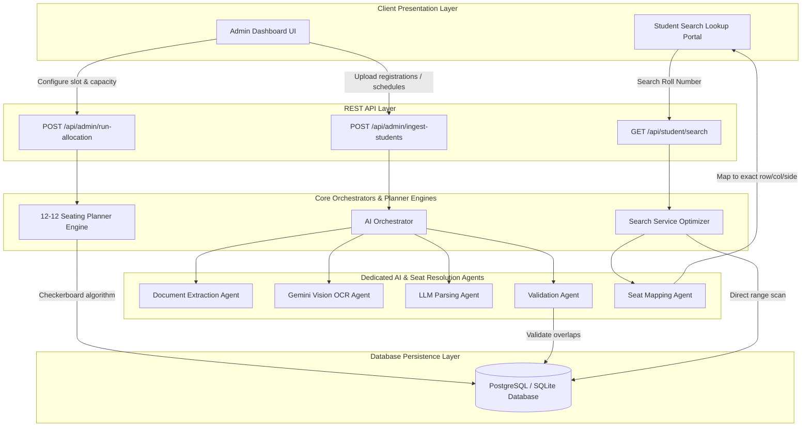

# AI-Powered Examination Seating Arrangement Finder & Automated Planner (SeatX)

An AI-powered, high-performance examination seating arrangement coordinator and public student finder portal. This application streamlines institutional exam coordination through automated mixed-subject checkerboard seat planning, AI document digitisation, multi-session active searches, and visual door chart generation.

---

## 🌟 Key Features

1. **"12-12" Mixed Seating Planner**: Pairs and distributes students of two different subjects horizontally and vertically to prevent academic malpractice.
2. **3D Checkerboard Grid Logic**: Automatically spaces seat allocations on double-benches side-by-side (Left vs Right) using the spatial coordinate formula:
   $$\text{Seat Index} = (\text{row} + \text{col} + \text{side}) \bmod 2$$
3. **Dynamic Classroom Capacities**: Supports customizable seat configs:
   * **1 Student per Bench (24/room capacity)**.
   * **2 Students per Bench (48/room capacity)** with automatic bench-mate subject separation.
4. **Cloud Database Persistence (Render PostgreSQL)**: Built-in dual database support using **PostgreSQL** in production for 100% data persistence across container restarts, and **SQLite** for offline local development.
5. **AI-Powered Notice Ingestion**: Upload scanned physical seating charts and board lists. Digitizes document images and PDFs using **Google Gemini Pro Vision OCR** and maps them to active database seating ranges.
6. **Multi-Session Active Search**: Allows administrators to toggle multiple exam sessions active concurrently. The student finder lookup scans across all active sessions in parallel.
7. **Executive Student Seating Slips & Interactive Room Grid Maps**:
   * Generates printable executive seating ticket slips with seat callouts and QR code validation frames.
   * Displays visual 2D classroom grid maps with podium bar indicators and color-coded seat status badges (*Your Seat*, *Occupied*, *Vacant*).
8. **Automated Door Chart Rendering**: Generates print-ready PDFs showing split-bench cards colored by subject using **ReportLab**.

---

## 📐 System Architecture

### A. Complete System & Planner Engine Flow (Mermaid Diagram)



---

## 🛠️ Technology Stack

* **Backend**: Python 3.10+, FastAPI, Uvicorn, PostgreSQL (`psycopg2-binary`), SQLite (`sqlite3`), ReportLab, pdfplumber, openpyxl.
* **Frontend**: React 19, Vite, Lucide Icons, Plus Jakarta Sans Typography, Custom Glassmorphic CSS Design System.
* **AI Integration**: Google Gemini API (Vision OCR & Document Parsing).
* **Cloud Infrastructure**: Render (FastAPI Web Service + React Static Site + Managed PostgreSQL).

---

## 📂 Project Structure

```text
├── backend/
│   ├── main.py                    # FastAPI entry point & lifespan handler
│   ├── routes.py                  # API endpoints (seating search, sessions, planner)
│   ├── database.py                # Dual DB wrapper (PostgreSQL & SQLite) and schemas
│   ├── allocation.py              # Seating Planner algorithm (12-12 mixed seating)
│   ├── ingestion.py               # Document extraction (PDF / Excel parsing)
│   ├── reports.py                 # ReportLab PDF door charts rendering engine
│   ├── agents.py                  # Gemini AI Orchestrator & SeatMappingAgent
│   ├── requirements.txt           # Backend Python dependencies
│   └── mits_exam.db               # Local SQLite database file
├── frontend/
│   ├── src/
│   │   ├── components/
│   │   │   ├── AdminPortal.jsx    # UI for uploads, planners, and sessions
│   │   │   └── StudentSearch.jsx  # UI for student seating search lookup
│   │   ├── App.jsx                # Client-side router and theme shell
│   │   └── index.css              # Glassmorphic design system and styling
│   └── package.json               # Frontend React dependencies
├── render.yaml                    # Render Blueprint Deployment Configuration
└── README.md                      # Project documentation manual
```

---

## 🚀 Installation & Local Setup

### 1. Backend Setup
1. Navigate to the backend workspace directory:
   ```bash
   cd backend
   ```
2. Create and activate a Python virtual environment:
   ```bash
   python -m venv venv
   # On Windows (PowerShell):
   .\venv\Scripts\Activate.ps1
   # On Linux/macOS:
   source venv/bin/activate
   ```
3. Install required Python packages:
   ```bash
   pip install -r requirements.txt
   ```
4. Run database initialization:
   ```bash
   python database.py
   ```

### 2. Frontend Setup
1. Navigate to the frontend directory:
   ```bash
   cd ../frontend
   ```
2. Install npm dependencies:
   ```bash
   npm install
   ```

---

## 🏃 Running the Application

### Run Backend API Server
In the root directory, launch the FastAPI server:
```bash
python -m backend.main
```
* **API Server**: `http://localhost:8085`
* **Swagger API Docs**: `http://localhost:8085/docs`

### Run Frontend Client
In the `frontend` folder, execute the Vite dev command:
```bash
npm run dev
```
* **Web Portal**: `http://localhost:5173`

---

## ☁️ Cloud Deployment (Render Blueprint)

The application includes a `render.yaml` blueprint ready for 1-click deployment on Render:

1. Connect your GitHub repository to [Render](https://dashboard.render.com/).
2. Create a new **Blueprint Service** from your repository.
3. Render automatically provisions:
   * **`seatx-backend`**: Python FastAPI Web Service.
   * **`seatx-frontend`**: React Vite Static Site.
   * **`seatx-postgres`**: Managed PostgreSQL Database.

---

## 🧪 Testing

* Run seating allocation checkerboard algorithm tests:
  ```bash
  python backend/test_allocation.py
  ```
* Run parsing and AI agent tests:
  ```bash
  python -m backend.test_agents
  ```
